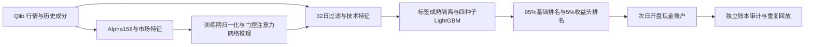

# 多因子 + LightGBM 融合选股策略

这是一个面向日频股票横截面选股的研究框架：先把多因子评分与 LightGBM 五日收益预测
转换为可比较的同日排名，再按 95%/5% 融合，最后用包含现金、T+1、整手、流动性和交易
成本约束的账户引擎进行次日开盘回测。

仓库包含 Qlib 行情读取、Alpha158 与市场特征计算、训练期归一化、市场门控截面注意力网络、
四种子 LightGBM、融合评分及独立现金账户审计。数据和模型权重需单独准备。

[持续集成](https://github.com/Q531531/multifactor-lightgbm-stock-selection/actions)



> 历史数值复现需要固定行情快照、历史股票池、同源基础分数或模型权重，以及一致的运行环境。
> 输入准备和验证范围见 [复现指南](docs/REPRODUCIBILITY.md)。

## 数据从哪里来

- 历史行情与沪深300成员区间：
  [chenditc/investment_data 的 2026-10-20 快照](https://github.com/chenditc/investment_data/releases/tag/2026-10-20)，
  采用 Qlib 二进制格式。
- 历史 95% 基础分数：由市场门控截面注意力网络推理生成，
  需要另行提供 `date/asset/multifactor_score`；行情下载包里没有这些预测分数。
- 合成示例：本仓库通过固定种子的 NumPy 随机数生成。

下载链接、版本、格式转换与基础分数准备方法见
[数据来源与获取方式](docs/DATA_SOURCES.md)。

## 项目做什么

- 将量纲不同的多因子分数和模型预测统一为横截面百分位排名。
- 用较小的模型权重增强传统多因子排序，降低模型信号直接主导组合的风险。
- 提供五日 LightGBM LambdaRank 训练、四种子集成和预测代码。
- 在信号日收盘后决策，下一交易日开盘执行，避免同日价格泄漏。
- 回测显式处理现金、持仓期、整手、成交量参与率、涨跌幅限制和交易费用。

## 核心策略

同一交易日内，先分别计算多因子分数和五日 LightGBM 收益头分数的横截面百分位排名，
再以固定权重融合：

```text
multifactor_rank = percentile_rank(multifactor_score) - 0.5
model_rank       = percentile_rank(model_score) - 0.5
fused_score      = 0.95 * multifactor_rank + 0.05 * model_rank
```

排名使用 `method="average"` 处理并列值。信号在收盘后形成，最早在下一交易日开盘执行。

## 基础分数网络

95% 基础分数来自一个同时建模时间序列和股票间关系的网络。每个交易日的输入是当日全部
有效成员过去 8 个交易日的 158 个 Alpha158 股票因子，以及沪深300、中证500、中证800
三个指数的 63 个市场特征，形状为 `[股票数, 8, 221]`：

1. **市场门控**：取最后一日市场特征，经线性层与温度为 5 的 softmax 得到 158 个因子权重，
   乘以 158 使平均权重为 1，再逐因子缩放全部 8 日的股票因子。市场状态由此决定当日
   哪些因子被放大或抑制。
2. **嵌入**：线性投影到 256 维，并叠加正弦位置编码标记回看日顺序。
3. **单股时间注意力**：每只股票在自己的 8 日窗口内做 4 头自注意力。
   采用前置 LayerNorm，注意力输出与输入残差相加后再做 LayerNorm 和两层前馈残差。
4. **截面注意力**：交换股票维与时间维，在同一回看日的全部股票之间做 2 头自注意力，
   分数除以 `sqrt(256 / 2)`，使每只股票的表示吸收同日其他股票的信息；块结构同上。
5. **时间聚合**：以最后一日的线性投影为查询，与各回看日投影做内积并 softmax，
   对 8 日表示加权求和。
6. **输出**：线性层得到每只股票一个分数，作为 `multifactor_score`。

训练时按交易日组批，去掉截面两端各 2.5% 的标签后做截面 z-score，
以忽略缺失标签的均方误差为损失，Adam 优化并按值裁剪梯度到 ±3。
推理阶段关闭 dropout，CPU 两线程、确定性算法、每日重复 4 次并要求结果一致。

## 训练与测试时间边界

以下日期由项目作者确认，均按日历日期记录：

| 项目 | 时间边界 |
| --- | --- |
| 基础 Transformer 权重训练截止 | **2022-12-31（含）** |
| 固定历史测试区间 | **2024-07-01 至 2026-10-20（两端含）** |

测试区间使用训练截止后固定的基础权重。LightGBM 配置中的
`train_end = "2023-01-01"` 是训练信号及标签成熟日期的排他上界；
`base-predict --fit-end` 另行控制归一化统计量的拟合边界。
权重训练截止与归一化统计边界分别记录，不能由后者推导前者。

## 内容

- `fusion.py`: 95% 多因子 + 5% 模型头的横截面排名融合。
- `model.py`: 五日 LambdaRank 头的四种子训练与推理代码。
- `data.py`: 行情长表、股票池与 NumPy 面板转换。
- `qlib_data.py`: 固定快照下载校验、原日线二进制读取和历史成分装配。
- `alpha_features.py`: Qlib 表达式计算 Alpha158 股票因子与 63 维市场特征。
- `market_transformer.py`: 市场门控、时间注意力、截面注意力与时间聚合网络，以及权重加载。
- `cross_section_training.py`: 按交易日组批的截面回归训练、保存与重载。
- `base_scores.py`: 训练期 median/MAD 归一化与基础分数推理。
- `features.py`: 32 日过滤、17 个技术特征与五日收益标签。
- `splits.py`: 按标签成熟日执行训练、早停、验证和评价切分。
- `pipeline.py`: `prepare/train/predict/backtest/audit` 完整命令入口。
- `backtest.py`: 现金约束、T+1、整手、成交量、费用和次日开盘执行。
- `metrics.py`: 收益、风险、费用和横截面 IC 指标。
- `audit.py`: 时间边界、独立账本审计与运行收据。
- `cli.py`: CSV/Parquet 分数融合命令。
- `tests/`: 无需外部行情和模型权重的合成回归测试。
- `examples/`: 可直接运行的合成端到端示例。
- `configs/original_protocol.toml`: 策略参数和训练、验证、评价时间边界。
- `configuration.py`: TOML 配置加载，命令行显式参数优先。
- `docs/DATA_CONTRACT.md`: 输入字段和时间边界约定。
- `docs/DATA_SOURCES.md`: 历史行情、股票池、基础模型和示例数据的来源及获取方式。
- `scripts/verify_historical.py`: 使用固定实验数据重训模型，逐字段核对特征、预测和账户结果。

## 安装

```bash
python3.11 -m venv .venv
source .venv/bin/activate
pip install -e ".[dev,train,parquet]"
python -m unittest discover -s tests -v
```

项目支持 Python 3.11 及以上。需要用网络生成基础分数时安装可选依赖：

```bash
pip install -e ".[deep]"
```

需要 PyTorch CPU 专用版本时，可先按 [PyTorch 安装说明](https://pytorch.org/get-started/locally/)
选择适合本机的包；推理默认使用 CPU。

仅使用已有预测分数进行融合时，不需要安装 LightGBM：

```bash
pip install -e .
```

## 融合分数

输入文件至少包含 `date`、`asset`、`multifactor_score` 和 `model_score`：

```bash
factor-fusion \
  --input scores.parquet \
  --output fused_scores.parquet
```

也可以在 Python 中调用：

```python
import pandas as pd
from original5_strategy import fuse_scores

scores = pd.read_parquet("scores.parquet")
fused = fuse_scores(scores)
```

## 完整流水线

### 0. 数据源和基础分数

```bash
# 可选：下载约 569 MB 固定快照并解压
strategy-pipeline download-data --destination data/snapshot

strategy-pipeline import-qlib \
  --provider data/snapshot/cn_data --output data/market.parquet

strategy-pipeline factor-features \
  --provider data/snapshot/cn_data --output outputs/factor_panel.npz

# 准备与网络配置匹配的权重文件
strategy-pipeline base-predict \
  --panel outputs/factor_panel.npz --weights /path/to/base_weights.pt \
  --output data/multifactor_scores.parquet \
  --start 2019-01-01 --fit-start 2018-01-01 --fit-end 2023-01-01
```

推理对 2019—2022 信号按信号年前的统计归一化，对 2023 及之后固定使用 2018—2022
统计；先对全体当日有效成员推理，再对齐 32 日策略样本。基础权重训练截止为
2022-12-31（含），具体测试区间见[训练与测试时间边界](#训练与测试时间边界)；
上面的 `--fit-end` 只控制本地标准化的时间边界。

也可直接提供符合接口的行情长表与基础分数，跳过上述数据源和网络推理步骤。

### 1. 准备特征和标签

```bash
strategy-pipeline prepare \
  --market data/market.parquet \
  --multifactor data/multifactor_scores.parquet \
  --output outputs/prepared.parquet \
  --panel-output outputs/panel.npz \
  --start 2019-01-01
```

### 2. 审计时间边界

```bash
strategy-pipeline audit \
  --prepared outputs/prepared.parquet \
  --output outputs/prepared_audit.json
```

### 3. 训练四种子模型

```bash
strategy-pipeline train \
  --prepared outputs/prepared.parquet \
  --models-dir outputs/models \
  --metadata outputs/training.json \
  --config configs/original_protocol.toml
```

### 4. 评价期预测与融合

```bash
strategy-pipeline predict \
  --prepared outputs/prepared.parquet \
  --models-dir outputs/models \
  --output outputs/fused_scores.parquet \
  --evaluation-start 2024-06-28
```

### 5. 账户回测

```bash
strategy-pipeline backtest \
  --market data/market.parquet \
  --scores outputs/fused_scores.parquet \
  --output-dir outputs/account_10bp \
  --start 2024-07-01 \
  --end 2026-10-20 \
  --bps 10 \
  --repeats 4
```

预测从 2024-06-28 开始，以提供 2024-07-01 成交所需的前一个交易日信号。
每个阶段都会输出运行收据。模型输出目录已有权重时拒绝覆盖，
推理时检查模型文件是否被改动，并阻止评价区间早于登记的验证边界。字段定义见
[数据接口约定](docs/DATA_CONTRACT.md)。

## 合成端到端示例

不准备任何外部数据也可以验证完整代码路径：

```bash
python examples/run_synthetic_pipeline.py --output synthetic_output
```

该示例会生成合成行情、构造示例多因子分数、训练两个小模型、完成融合和四次一致回放。
它只验证工程流程，不代表历史策略表现。

## 单独训练模型

仓库不提供任何权重。使用自己的训练集时，必须先在外部固定训练/早停/评价边界，
并保证训练标签在验证区间开始前已经成熟：

```python
from original5_strategy.model import fit_ensemble, predict_ensemble

features = ["feature_1", "feature_2", "feature_3"]
models = fit_ensemble(train_frame, validation_frame, features)
prediction = predict_ensemble(models, evaluation_frame[features])
```

训练默认使用固定策略配置：四种子 `23/37/53/71`、600 棵树上限、60 轮早停、
LambdaRank、NDCG@30 和十档相关性标签。数据清洗、股票池构造与时间切分由调用方完成。

## 回测

`backtest` 接收 NumPy 面板和按信号日组织的分数。默认配置为 30 股、最短持仓 5 日、
单边每日成交上限 10%、佣金 3bp、滑点 10bp、卖出印花税 5bp、1% 成交量参与率。
详细字段见 [数据接口](docs/DATA_CONTRACT.md)。

## 边界

- 这是研究代码，不构成投资建议。
- 历史数值取决于同源数据、模型和运行环境，输入要求见 [复现指南](docs/REPRODUCIBILITY.md)。
- 基础分数和行情输入需符合数据接口约定。
